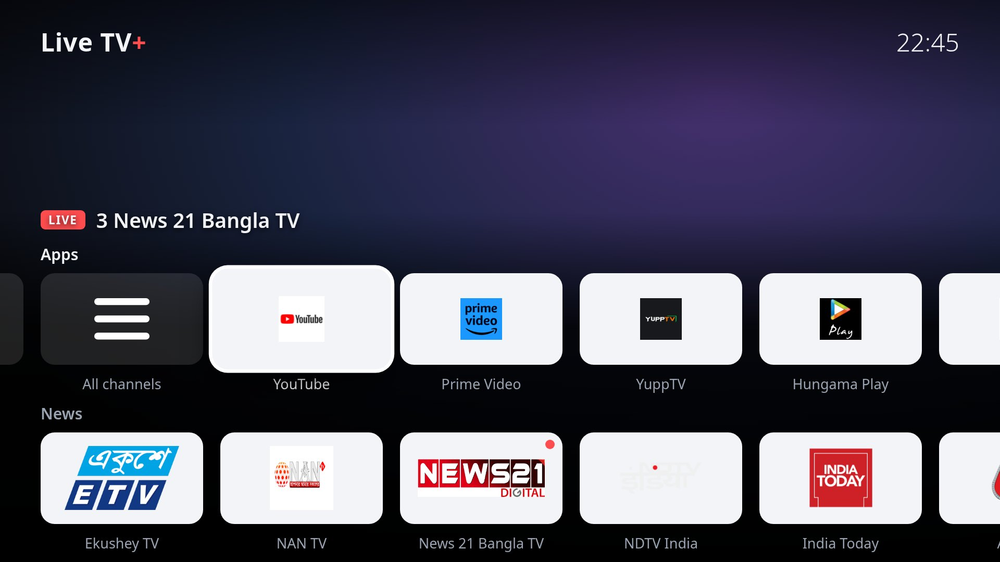
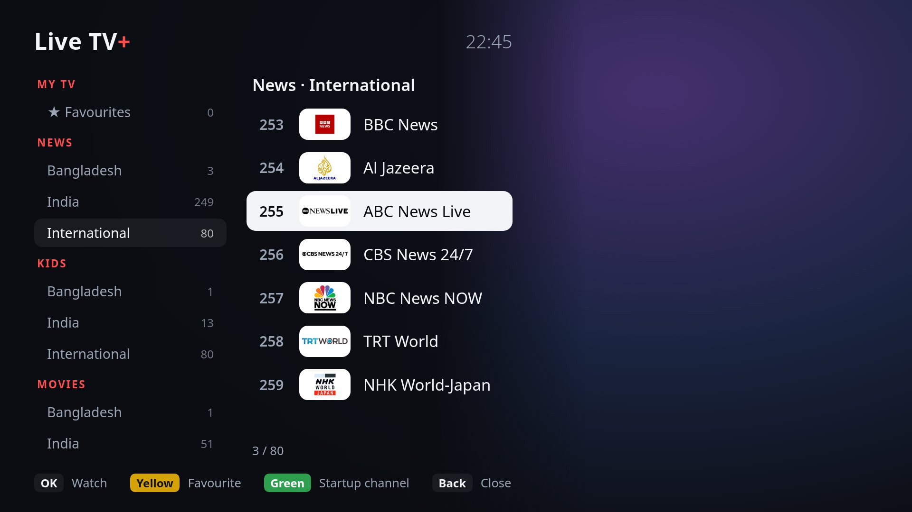

<h1 align="center">Live TV+ for LG webOS</h1>

<p align="center">
  A clean live-TV home screen for LG webOS TVs. Your TV opens on a news channel instead of
  “No signal”, with your apps and channel rows on top. No root needed.
</p>

<p align="center">
  <a href="https://github.com/devgalib/livetv-plus-webos/actions/workflows/ci.yml"></a>
  <a href="LICENSE"></a>
  
  
</p>

<p align="center"></p>

TVs without an aerial show LG's “No signal / Not programmed” screen every time they turn on.
Live TV+ replaces it: the TV opens on a live news channel with a dock of your apps and rows of
news, kids, movie and music channels from Bangladesh, India and around the world. The design is
modelled on the no-root LG webOS ports listed in [cleanyourtv](https://github.com/Gathin23/cleanyourtv).

## Features

- **Starts on the news.** At power-on the TV opens on your startup channel (a news channel unless you
  pick another). If that channel is off air, it moves on to the next news channel by itself.
- **Replaces LG's screens.** The antenna “No signal” screen and the Home button bring Live TV+ back
  within about two seconds.
- **App dock.** YouTube, Prime Video and the rest of your TV's apps, plus an LG Home tile.
- **600+ checked channels.** News, Kids, Movies and Music from Bangladesh, India and international
  broadcasters. Every stream is test-played when the list is built. Adult, religious and shopping
  channels are always left out.
- **Built for the remote.** Big focus glow, channel numbers, favourites (Yellow), startup channel
  (Green), and a full channel list.
- **Light.** Plain HTML/JS and a small Node.js service. It runs on webOS 4.5's Chrome 53 and Node.js 0.12.

<p align="center"></p>

## How it works

| Part | Folder | What it does |
| --- | --- | --- |
| App | [`webos-app/`](webos-app) | Player (native webOS HLS, with [hls.js](https://github.com/video-dev/hls.js) as backup), home screen and channel list. |
| Home helper | [`webos-service/`](webos-service) | Background service installed with the app. A persistent Activity Manager timer opens Live TV+ at boot. A subscription to the TV's local control API (SSAP) brings it back over the antenna screen. It also lists and launches apps for the dock. |
| Channel builder | [`scripts/build-channels.mjs`](scripts/build-channels.mjs) | Builds `webos-app/channels.js` from the public [iptv-org](https://github.com/iptv-org/api) database and keeps only streams that actually load. |

LG Home on webOS 4.5 is drawn on top of the current app without changing the foreground app. So the
app tells the helper when it gets hidden. If Live TV+ is still the foreground app a moment later,
the cover is LG Home, and the helper brings Live TV+ back.

## Requirements

- An LG webOS TV. Tested on a 32LM636BPTB, webOS 4.5 (firmware 05.40.97). Other models should work;
  reports are welcome.
- The TV and a computer on the same network.
- On the computer: Node.js 18+ and git.
- A free LG developer account, for the TV's Developer Mode app.

## Install

1. **Developer Mode.** On the TV, install **Developer Mode** from the LG Content Store. Sign in with
   your LG developer account (free at <https://webostv.developer.lge.com>) and turn **Dev Mode Status**
   on. The TV restarts.
2. **Get the code.**

   ```bash
   git clone https://github.com/devgalib/livetv-plus-webos.git
   ```

   ```bash
   cd livetv-plus-webos && npm install
   ```

3. **Connect to the TV.** In Developer Mode, turn **Key Server** on. Register the TV, using its IP
   address from the Developer Mode screen, then fetch its key. The second command asks for the
   passphrase shown on the TV:

   ```bash
   npx ares-setup-device --add tv --info "host=192.168.1.50" --info "port=9922" --info "username=prisoner"
   ```

   ```bash
   npx ares-novacom --device tv --getkey
   ```

   If you mistype the passphrase, `bash tools/set-passphrase.sh` saves it again and checks it.

4. **Build and install.**

   ```bash
   npm run package
   ```

   ```bash
   npm run install-tv
   ```

   Ready-made `.ipk` files are also attached to each
   [release](https://github.com/devgalib/livetv-plus-webos/releases). Install one with
   `npx ares-install --device tv <file>.ipk`.

5. **Approve the helper.** The first time the app opens, the TV asks: *Connection request: LG Remote
   App*. Answer **Yes**. That pairs the Home helper with the TV's local control API.

Developer Mode sessions expire. Open the Developer Mode app now and then and press **Extend Session
Time**. If the session runs out, webOS removes sideloaded apps, and you install again with step 4.

## Remote control

| Button | Home screen | Watching full screen | Channel list |
| --- | --- | --- | --- |
| **Arrows** | Move between tiles | **▲ ▼** change channel, **◀ ▶** open the list | Move; **◀ ▶** switch between categories and channels |
| **OK** | Open the tile (a channel plays full screen) | Open the channel list | Play |
| **Back** | Watch full screen | Back to the home screen | Close |
| **CH + / −** | Change channel | Change channel | Jump a page |
| **0–9** | — | Go to a channel number | — |
| **Yellow** | Add / remove favourite | Add / remove favourite | Add / remove favourite |
| **Green** | Make it the startup channel | Make it the startup channel | Make it the startup channel |
| **Blue** | Turn the Home helper back on | same | same |

After 45 seconds without a key press, the home screen fades and the channel plays full screen.

**Getting to LG Home:** use the **LG Home** tile, or press Home three times within 10 seconds. Either
pauses the helper for 10 minutes. **Blue** turns it back on.

## Known limits

- Pressing Home *inside another app* (YouTube, Prime Video, …) shows LG's bar, because webOS gives
  apps no signal for it. Pick Live TV+ from the bar, or leave the app with **Back**. Catching this
  case needs direct access to the remote, which only a rooted TV allows.
- After a cold boot it can take a few seconds before Live TV+ appears.
- Streams come from public sources and go up and down. Rebuild the list now and then (see below).

## Development

```bash
npm run check      # ES5 + manifest checks (the TV runs Chrome 53 and Node.js 0.12)
npm start          # preview the app at http://localhost:8090 (apps are simulated)
npm run channels   # rebuild the channel list and test-play every stream (~5 min)
```

The helper writes a log on the TV:

```bash
npx ares-novacom --device tv --run "tail -30 /media/developer/apps/usr/palm/services/com.devgalib.livetv.service/helper.log"
```

[`tools/tv.js`](tools/tv.js) drives the TV over its local control API, which is handy for testing:

```bash
TV_IP=192.168.1.50 node tools/tv.js foreground
```

Other commands: `info`, `apps`, `launch <appId>`, `keys HOME,DOWN,ENTER`, `shot out.jpg` and
`request <ssap uri> [json]`.

See [CONTRIBUTING.md](CONTRIBUTING.md) for how to propose changes.

## Content disclaimer

Live TV+ does not host, store or re-stream any video. It plays publicly listed streams from the
community-maintained [iptv-org](https://github.com/iptv-org/iptv) database, straight from their
sources. Channel names and logos belong to their owners. If you own a channel and want it removed,
[open a channel issue](https://github.com/devgalib/livetv-plus-webos/issues/new?template=channel.yml)
and it will be dropped from the list.

Live TV+ is not affiliated with or endorsed by LG Electronics. LG and webOS are trademarks of
LG Electronics.

## Credits

- [cleanyourtv](https://github.com/Gathin23/cleanyourtv) and its no-root LG webOS ports, for the idea and the home-screen model.
- [iptv-org](https://github.com/iptv-org) for the public channel database.
- [hls.js](https://github.com/video-dev/hls.js) (Apache-2.0) and [lgtv2](https://github.com/hobbyquaker/lgtv2) (MIT). See [THIRD_PARTY_NOTICES.md](THIRD_PARTY_NOTICES.md).

## License

[MIT](LICENSE) © 2026 Asadullah Hil Galib
